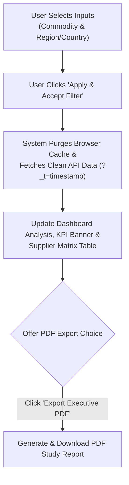

# Specification Document: Semiconductor Equipment Commodity & Supplier Study Platform
*Global Supply Chain Intelligence, Category Deep Dives & Executive PDF Report Generator*

---

## 1. Overview
The **Semiconductor Equipment Commodity & Supplier Study Platform (CHIPCHAIN)** is an enterprise supply chain analytics and intelligence system built specifically for semiconductor equipment manufacturing. Designed from the persona of a seasoned supply chain director and supplier quality engineer (SQE), the tool enables procurement, sourcing, and engineering teams to conduct targeted commodity deep-dives and analyze global supplier profiles across major semiconductor manufacturing hubs.

The system integrates dynamic real-time data filtering, category-specific material specs, quality/contamination benchmarks, and financial solvency tracking aligned with global semiconductor manufacturing standards.

---

## 2. Role & Persona
* **Role Title:** Experienced Supply Chain & Quality Professional in Semiconductor Equipment Manufacturing.
* **System Persona:** Acts as a senior strategic sourcing director and supplier quality engineering lead capable of in-depth component research, evaluating supplier capabilities, cost structures, contamination protocols, failure analysis SLA, and business continuity metrics.

---

## 3. Input Requirements
The application accepts three mandatory sourcing inputs from the user:

| Input Field | Type | Required | Example Inputs | Description |
| :--- | :--- | :--- | :--- | :--- |
| **Commodity** | String | Yes | Advanced Ceramics, Precision Machining, Specialized Welding, Cable Harnesses, Circuit Boards | The target semiconductor equipment manufacturing commodity category. |
| **Region** | String | Yes | Asia, North America, Europe, Middle East, All | The target geographical region for global supplier mapping. |
| **Country** | String | Yes | Japan, South Korea, Taiwan, USA, Netherlands, Germany, Israel, All | Dynamically populated country filter per selected region. |

---

## 4. Global Supplier Coverage & Data Resolution Strategy
The system resolves global suppliers and commodity deep-dive metrics using a multi-tiered architecture with structured document persistence and dynamic REST API filtering:

1. **Python REST API Server & Environment (`.env`):** Server ([`server.py`](file:///c:/Users/Lalit.MSI/Documents/Education/AntiGravity/my_app/Commodity_Study/server.py)) powered by [`.env`](file:///c:/Users/Lalit.MSI/Documents/Education/AntiGravity/my_app/Commodity_Study/.env) environment configuration (`PORT=8085`, `HOST=127.0.0.1`, `DATABASE_FILE=database.json`).
2. **Curated Sector Knowledge Base ([`database.json`](file:///c:/Users/Lalit.MSI/Documents/Education/AntiGravity/my_app/Commodity_Study/database.json)):** Catalog of leading suppliers across four major geographical regions:
   * **Asia:** Japan (Kyocera, Ferrotec), South Korea (Wonik QnC), Taiwan (Foxsemicon), Singapore (UMS Holdings), China.
   * **North America:** USA (CoorsTek, Ultra Clean Technology, Ichor Systems, Benchmark Electronics), Canada, Mexico.
   * **Europe:** Netherlands (VDL ETG), Switzerland (VAT Group), Germany (Trumpf, SCHOTT), France.
   * **Middle East:** Israel (Barkan Mount, Arotech), UAE.
3. **Hierarchical Sorter:** Sorts commodities by **Market Size ($ TAM)** descending as default for executive market analysis, and sorts suppliers by **Region $\rightarrow$ Country $\rightarrow$ City** (Spec Default) for structured regional evaluation.

---

## 5. Research Scope & Commodity Deep Dive Deliverables

### 5.1 Category Deep Dive Intelligence
Dynamically renders category-specific technical metrics when selected:
* **Advanced Ceramics ($4.2B TAM | CAGR +7.4%):** High-purity Alumina ($Al_2O_3$), Silicon Carbide (SiC), Quartz, AlN; Plasma etch chambers, E-Chuck top plates; Dielectric strength $> 15 \text{ kV/mm}$, erosion rate $< 0.1 \text{ nm/min}$.
* **Precision Machining ($8.5B TAM | CAGR +6.8%):** 5-axis CNC machining, vacuum chambers, gas showerheads; Vacuum tightness $1 \times 10^{-9} \text{ Torr}$, 100% CMM verification.
* **Specialized Welding ($2.8B TAM | CAGR +5.9%):** Electron beam, orbital TIG, laser welding; UHP gas delivery lines; Purge Argon 6N (99.9999%), helium leak rate $< 1 \times 10^{-10} \text{ atm}\cdot\text{cc/s}$.
* **Cable Harnesses & Interconnects ($3.1B TAM | CAGR +8.1%):** Cleanroom ISO Class 1/10 cabling, high-flex robotics, RF feedthroughs; ASTM E595 outgassing (TML $< 0.5\%$), 10M+ flex cycles.
* **Circuit Boards / PCBAs ($6.7B TAM | CAGR +9.2%):** High-density interconnect (HDI) PCBs, RF generator boards; IPC Class 3, controlled impedance $\pm 5\%$, AOI inspection.

### 5.2 Comprehensive Supplier Profile Metrics
Detailed supplier profile attributes including:
* **General Metadata:** Legal Name, Est. Year, Employees
* **Financial Health & Solvency:** Free Cash Flow ($M), 3-Year Annual Revenue History ($M for 2023, 2024, 2025), 3-Year R&D Investment Trend ($M for 2023, 2024, 2025)
* **Commodity Concentration & Focus:** Percentage of Corporate Revenue derived directly from target semiconductor commodity category (% share)
* **Products & Services Portfolio:** Product/Service Category Revenue Contribution Breakdown (% share)
* **Technical Capabilities:** Max Part Size ($L \times W \times H$), Monthly Output Capacity
* **Quality & Performance:** On-Time Delivery (OTD %), Prototype & Volume Lead Times
* **Cost Structure:** Direct Labor ($/hr), Burden Rate ($/hr), Target Profit Margin (%)
* **CAD Formats:** STEP (.stp), IGES (.igs), SolidWorks (.sldprt), Gerber RS-274X, ODB++
* **Process FMEA:** RPN scores ($S \times O \times D$) & mitigating controls
* **Failure Analysis:** SEM/EDS, 3D X-Ray CT, FTIR, SAM, 24–48h 8D SLA
* **Contamination Control:** Cleanroom ISO Class 1–7, particle size limits, $18.2 \text{ M}\Omega\cdot\text{cm}$ DI UPW resistivity
* **Business Continuity (BCP):** Dual-site redundancy, RTO (hours), ISO 22301 BCMS
* **Logistics & Incoterms:** FCA/DDP, airport/sea hubs, ShockWatch crating, automated ASN with GPS telemetry
* **Data Sharing:** Cloud Portal, REST API, ERP-to-ERP EDI

---

## 6. Technology Stack & Environment
* **Backend:** Python HTTP & REST API Server ([`server.py`](file:///c:/Users/Lalit.MSI/Documents/Education/AntiGravity/my_app/Commodity_Study/server.py), [`.env`](file:///c:/Users/Lalit.MSI/Documents/Education/AntiGravity/my_app/Commodity_Study/.env) configuration loader).
* **Data Store:** JSON Document Store ([`database.json`](file:///c:/Users/Lalit.MSI/Documents/Education/AntiGravity/my_app/Commodity_Study/database.json)).
* **Frontend:** Web Interface ([`index.html`](file:///c:/Users/Lalit.MSI/Documents/Education/AntiGravity/my_app/Commodity_Study/index.html), [`styles.css`](file:///c:/Users/Lalit.MSI/Documents/Education/AntiGravity/my_app/Commodity_Study/styles.css), [`app.js`](file:///c:/Users/Lalit.MSI/Documents/Education/AntiGravity/my_app/Commodity_Study/app.js)).
* **Output Format:** Interactive Web Dashboard & Multi-page Executive PDF Report Package (`html2pdf.js`, `html2canvas`, `jsPDF`).

---

## 7. Output Presentation & Executive Report Specification
The output is structured as a Professional Executive Study Report Package:
* **Section 1: Executive Header & Metadata:** Category Title, Regional Focus, Country Filter, Timestamp.
* **Section 2: Summary KPI Dashboard Banner:** Total Active Suppliers Tracked, Avg On-Time Delivery %, Combined R&D Spend ($M), Combined Free Cash Flow ($M).
* **Section 3: Embedded Commodity Deep Dive Details:** Category description, material substrates, target applications, key technical attributes, quality benchmarks, market TAM, CAGR, and lead times.
* **Section 4: Global Supplier Profiles & Capabilities Matrix:** Multi-page matrix table detailing supplier names, founding year, headcount, location, OTD %, solvency, prototype/volume lead times, cost margins, CAD inputs, and ERP integration protocols.

---

## 8. UI Workflow & Interaction Specifications

### 8.1 Sourcing Input & Analysis Flowchart

### 8.2 Interactive Workflow Steps
1. **Input Selection:** User configures target **Commodity**, **Region**, and **Country** using the `#commodity-select`, `#region-select`, and `#country-select` control bar options.
2. **Filter Acceptance:** User clicks the **"Apply & Accept Filter"** button (`#apply-filter-btn`) to confirm their sourcing selection.
3. **Dynamic Analysis Update:** Upon filter acceptance, the system purges browser `localStorage` and `sessionStorage`, resets approval history, fetches clean data from the Python API server (`?_t=timestamp`), and updates the KPI banner, deep-dive technical metrics, and global supplier matrix.
4. **PDF Export Choice:** Once the analysis and report rendering is complete, the user is offered the choice to export the study package to PDF via the **"Export Executive PDF"** button (`#export-pdf-btn`).
5. **Reset & Clear Cache:** Dedicated `#reset-cache-btn` resets inputs to defaults, clears cache, re-fetches clean API data, and displays visual Toast notifications.
6. **Executive Slide Deck:** Dedicated `#launch-slides-btn` in header bar launching the interactive executive slide presentation module.

---

## 9. Interactive Executive Slide Deck Module (`executive_slide_deck.html`)
The system includes a dedicated, user-approved interactive slide presentation system (`executive_slide_deck.html`):

* **Slide 1: Title & Executive Overview:** $25.3B Total Sourcing Scope, Executive Objectives, Core Technical Deliverables across Asia, NA, Europe, and Middle East.
* **Slide 2: Market Sizing, 2025 Revenue & 3-Year Solvency Breakdown:** Interactive **Doughnut Chart (Chart.js)** displaying $25.3B TAM breakdown, **Bar Chart** of 2025 cumulative supplier revenues by commodity, and **3-Year Stacked Bar Chart** analyzing multi-year supplier revenue trends (2023–2025).
* **Slide 3: Category Deep Dives & Quality Benchmarks:** Technical specifications for ceramics ($15 \text{ kV/mm}$ dielectric), precision machining ($1 \times 10^{-9} \text{ Torr}$ vacuum tightness), UHP welding ($99.9999\%$ Argon purge), and cleanroom cabling (ISO Class 1).
* **Slide 4: Supplier Market Share by Selected Commodity:** Dynamic commodity selector & interactive **Market Share Donut / Bar Chart** displaying market share % and 2025 revenue ($M) for top semiconductor equipment suppliers (e.g. UCT, FITI, Ferrotec, Edwards, VAT Group, Kyocera, MKS, Brooks) in the chosen commodity category.
* **Slide 5: Global Supplier Ecosystem & Regional Hubs:** Multi-region capability breakdown with an interactive **On-Time Delivery (OTD %) Bar Chart** comparing Europe (97.1%), Asia (96.4%), North America (95.8%), and Middle East (94.2%).
* **Slide 6: Cost Structure, FMEA & Risk Mitigation:** Cost structure drivers ($35–$110/hr labor), acoustic emission FMEA controls, 24/48h 8D SLA, and **direct download links for executive standards PDFs**.
* **Interactive Controls & PDF Exporter:** Slide-by-slide navigation buttons, direct slide jump dots, and a **One-Click Header PDF Export (`exportToPDF()`)** rendering high-resolution multi-page slide decks.

