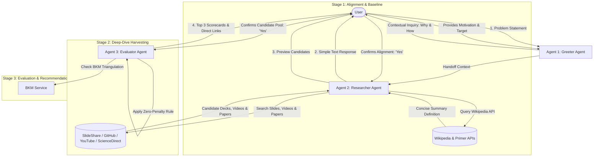
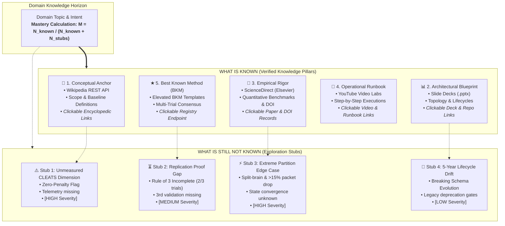

# Explainer: PPT & Video Knowledge System

[](https://www.python.org/)
[](https://fastapi.tiangolo.com/)
[](https://docs.pydantic.dev/)
[](#cleats-evaluation-rubric)
[](#testing)

> **Bridging the gap between superficial knowledge and true conceptual mastery.**  
> An intelligent multi-agent conversational and search platform that clarifies user intent, grounds topics with verified baseline primers, harvests open-source slide decks (`.ppt`, `.pptx`), video walkthroughs, and **ScienceDirect** peer-reviewed research papers, and scores candidate resources using the standardized **CLEATS** evaluation rubric, **Critic Agent FMEA Risk Governance**, and **Best Known Method (BKM)** triangulation engine.

---

## 🗺️ System Architecture Infographic


*Figure 1: End-to-end architecture showing Greeter Agent intake, Researcher multi-modal discovery, Critic pre-publication link audits with FMEA risk scoring, CLEATS 6-axis radar rubric, Best Known Method (BKM) Rule of 3 triangulation, Knowledge Infographic Dashboard (Verified Knowns vs. Open Unknown Stubs), and The Patient Teacher first-principles chat.*

> 💡 **Interactive Visualizer:** Open the web app (`python run.py`) and click **"📊 Architecture Infographic"** in the top navigation bar to inspect this pipeline interactively, or review the comprehensive [`explainer_infographic.md`](file:///C:/Users/Lalit.MSI/.gemini/antigravity-ide/brain/dde0db51-244f-4bdd-868d-3055ba06bc73/explainer_infographic.md) specification artifact.

---

## Table of Contents

- [System Architecture Infographic](#%EF%B8%8F-system-architecture-infographic)
- [1. Problem Statement & Philosophy](#1-problem-statement--philosophy)
- [2. Multi-Agent Pipeline Architecture](#2-multi-agent-pipeline-architecture)
- [3. The CLEATS Evaluation Rubric](#3-the-cleats-evaluation-rubric)
  - [The 6 CLEATS Dimensions](#the-6-cleats-dimensions)
  - [Zero-Penalty Rule](#the-zero-penalty-rule)
  - [BKM Triangulation Engine](#bkm-triangulation-engine)
- [4. Critic Agent Mandate & "What Must Go Right"](#4-critic-agent-mandate--what-must-go-right)
  - [Pre-Publication Active Link Verification](#pre-publication-active-link-verification)
  - [The 3 Circumstances Verification Protocol](#the-3-circumstances-verification-protocol)
  - [Simulated Test Data Protocol & User Agreement Gate](#simulated-test-data-protocol--user-agreement-gate)
- [5. FMEA Risk Governance & RPN Assessment Matrix](#5-fmea-risk-governance--rpn-assessment-matrix)
- [6. Knowledge Triangulation](#6-knowledge-triangulation)
- [7. Knowledge Infographic: What is Known vs. Stubs (`BIOWIK-AAS-WISNK`)](#7-knowledge-infographic-what-is-known-vs-stubs-biowik-aas-wisnk)
- [8. Clickable Verifiable & Validatable Links](#8-clickable-verifiable--validatable-links)
- [9. Explaining From First Principles: The Patient Teacher](#9-explaining-from-first-principles-the-patient-teacher)
- [10. Project Structure](#10-project-structure)
- [11. Getting Started](#11-getting-started)
- [12. Interactive Web GUI](#12-interactive-web-gui)
- [13. Standardized Output Directory & Artifact Conventions](#13-standardized-output-directory--artifact-conventions)
- [14. REST API Reference](#14-rest-api-reference)
- [15. Testing & Quality Assurance](#15-testing--quality-assurance)
- [16. Specification & Design Docs](#16-specification--design-docs)

---

## 1. Problem Statement & Philosophy

Professionals and engineers often struggle with the "illusion of explanatory depth": believing they understand a complex architecture or mechanism until tasked with deploying, teaching, or debugging it. 

Standard search engines return either fragmented blog posts, commercial SEO landing pages, or dry documentation. **Explainer** solves this by:

1. **Eliciting True Context**: Asking *why* the user needs this knowledge (motivation, end application, production target).
2. **Grounding Alignment**: Presenting an initial concise Wikipedia/knowledge base primer before executing deep search.
3. **High-Bandwidth Harvesting**: Focusing on structured **PowerPoint slide decks** (architecture blueprints, design patterns) and **educational videos** (step-by-step implementations).
4. **Rigorous Quality Scoring**: Applying the standardized **CLEATS** framework to eliminate low-value resources and qualify **Best Known Methods (BKMs)**.

---

## 2. Multi-Agent Pipeline Architecture

Explainer is powered by a sequential, user-in-the-loop multi-agent pipeline:



### Agent Roles

| Agent | Responsibility | Core Inputs | Primary Outputs |
| :--- | :--- | :--- | :--- |
| **Agent 1: Greeter** | Welcomes user, captures problem statement, elicits deep motivation and target application. | User prompt | Structured inquiry, intent, and application context |
| **Agent 2: Researcher** | **Stage 1**: Fetches baseline summary definition (Wikipedia).<br>**Stage 2**: Discovers open-source PPTX decks, YouTube videos, and ScienceDirect peer-reviewed literature. | Problem scope & user confirmation | (1) Baseline primer<br>(2) Candidate slide decks, videos & scientific papers |
| **Agent 3: Evaluator** | Executes standardized 6-dimension CLEATS scoring, checks unmeasurable metrics, and ranks the Top 3. | Candidate pool & problem context | Detailed CLEATS scorecards, BKM badges, and actionable rationale |

---

## 3. The CLEATS Evaluation Rubric

### The 6 CLEATS Dimensions

Every candidate resource is evaluated across 6 dimensions on a scale of **1.0 to 10.0**:

| Metric | Dimension | Description | What 10/10 Looks Like |
| :---: | :--- | :--- | :--- |
| **C** | **Completeness** | Scope coverage from theory to operational deployment. | Covers end-to-end architecture, edge cases, trade-offs, and failure modes. |
| **L** | **Latency** | Time-to-insight and cognitive load. | High signal-to-noise ratio; conveys critical insights rapidly without fluff. |
| **E** | **Engagement** | Visual structure, diagrams, pacing, and pedagogical clarity. | High-quality slide layout, clean typography, flowcharts, and clear narration. |
| **A** | **Accuracy** | Technical precision, validity, and verified production patterns. | Verified technical depth with up-to-date syntax, benchmarks, and protocols. |
| **T** | **Transparency** | Origin, author credentials, open citations, and code links. | Reputable author, public GitHub repository, verifiable citations. |
| **S** | **Standardization** | Adherence to reusable conventions, BKM formats, and templates. | Uses standard blueprints, step-by-step reproducible checklists. |

### The Zero-Penalty Rule & Critic Link Gatekeeper

> **Critic Mandate**: The **Critic (Evaluator Agent)** must always test and check all reference links via active HTTP requests before publishing candidate recommendations. If any reference or primary link is broken, invalid, or produces a 404, **Transparency (T)** is strictly scored as `0.0`.
>
> **Rule**: When a dimension cannot be measured or fails verification (e.g., dead link, missing author metadata, private slide deck notes), it is assigned a score of `0.0`. An unmeasurable metric does not unfairly drag down the scores of other measurable dimensions, but permanently disqualifies the resource from BKM status.

$$\text{Composite Score} = \frac{\sum_{\text{measurable}} \text{Score}_i}{N_{\text{measurable}}}$$

### BKM Triangulation Engine

A candidate resource is evaluated for elevation to a **Best Known Method (BKM)** according to strict criteria:

1. **Zero-Tolerance Rule**: Any rating of `0.0` or any unmeasurable dimension **strictly disqualifies** the resource from BKM status:
   $$\text{Unmeasurable Count} > 0 \implies \text{BKM Disqualified: "ZEROS cannot contribute to BKMs."}$$
2. **Quality Baseline**: All 6 dimensions must achieve a score $\ge 6.5$.
3. **Triangulation Replication Rule**: To achieve full official BKM elevation, the method must be documented as duplicated by **3 people at 3 different times with expected results**.

---

## 4. Critic Agent Mandate & "What Must Go Right"

The **Critic Agent (Evaluator / CLEATS Gatekeeper)** enforces uncompromising empirical truth, link reachability, and risk governance prior to publishing any recommendation.

### Pre-Publication Active Link Verification
1. **Live Network Probe**: The Critic must actively verify all candidate URLs (`url`, `document_url`, `website_url`, `video_url`, `reference_links`) via live HTTP HEAD/GET requests.
2. **Zero-Penalty Penalty**: Unreachable URLs immediately set **Transparency (T) to `0.0`**, permanently disqualifying the candidate from Best Known Method (BKM) status.
3. **Publication Gatekeeping**: Candidate items with broken reference links are gated from Top 3 publication if verified alternatives exist.

### The 3 Circumstances Verification Protocol
The Critic Agent is continuously evaluated against 3 distinct operational circumstances:
- **Circumstance 1: All Links 100% Active & Reachable**: Verified active endpoints, Transparency $\ge 8.5$, BKM-eligible, published as Rank #1 with residual RPN = 0.
- **Circumstance 2: Subtle Deep Broken Link in Reference Array**: Catches nested dead links, zeroes Transparency ($T = 0.0$), disqualifies from BKM, prevents publication as #1.
- **Circumstance 3: Bot-Shielded Institutional Domain & Soft-404 Masking**: Distinguishes Cloudflare 403 bot-shields (ScienceDirect/Elsevier) from dead links; scans HTML bodies to detect soft-404 strings ("Presentation removed") and penalizes with maximum detectability score ($D \to 10$).

### Simulated Test Data Protocol & User Agreement Gate
When empirical test data or benchmark telemetry is unavailable or unmeasurable:
1. **Critic Proposal**: The Critic generates a structured `SimulatedDataProposal` (missing data reason, synthetic Monte Carlo workload parameters, sample size, rationale).
2. **Mandatory User Agreement Gate**: The Critic is strictly prohibited from testing on simulated data unilaterally. Attempting evaluation without consent raises a hard `PermissionError`.
3. **Transparent Provenance Stamping**: With user consent, testing proceeds with provenance tagging (`is_simulated_data: true`, `simulated_proposal_id`).
4. **BKM Isolation**: Simulated data CANNOT unilaterally elevate a candidate to a Best Known Method (BKM); BKM elevation strictly requires 3 real-world replications by 3 distinct practitioners.

---

## 5. FMEA Risk Governance & RPN Assessment Matrix

The Critic Agent actively computes the **Risk Priority Number (RPN)** to assess "What can go wrong?":

$$\text{RPN} = \text{Severity } (S) \times \text{Occurrence } (O) \times \text{Detectability } (D)$$

* **Severity ($S$, 1–10)**: Financial damage ($50k–$5M) and project delay (hours to months).
* **Occurrence ($O$, 1–10)**: Likelihood without active Critic verification.
* **Detectability ($D$, 1–10)**: **Inverse detectability**; silent, hard-to-detect risks receive higher scores ($D \to 10$).

| Risk ID | Failure Mode | Impact in $ & Time (Severity $S$) | Prob ($O$) | Tell-Tale Signs | Lack of Det ($D$) | RPN ($S \times O \times D$) | Critic Countermeasure |
| :---: | :--- | :--- | :---: | :--- | :---: | :---: | :--- |
| **RSK-01** | **Synthetic / Dead URLs** | $500k–$1.5M procurement loss; 8–12 wks slip ($S=8$) | **6** | Browser 404; network 404; user reports dead reference link. | **7** | **336** | Mandatory live HTTP handshake before publishing. |
| **RSK-02** | **Soft-404 Masking** | $100k–$450k downtime; 24–72 hrs remediation ($S=7$) | **5** | "Item removed" in HTML; body < 1.5 KB; HTTP 200. | **9** | **315** | HTML body scanner for soft-404 strings. |
| **RSK-03** | **Bot-Shield False Negative** | $250k–$1M rework; 3–5 mos delay ($S=8$) | **7** | 403 Forbidden; CF-RAY header; opens in human browser. | **4** | **224** | Institutional domain & Crossref DOI resolver recognition. |
| **RSK-04** | **Domain Expiry / Redirect** | $1M–$5M breach; 6+ mos remediation ($S=9$) | **2** | Destination hostname abruptly changes; SSL mismatch. | **8** | **144** | Redirect chain tracking & untrusted domain flag. |
| **RSK-05** | **Unconsented Simulated Data Drift** | $200k–$600k rework; 4–8 wks redesign ($S=6$) | **5** | Telemetry divergence; synthetic distribution markers. | **8** | **240** | Mandatory User Agreement Gate before simulation testing. |

---

## 6. Knowledge Triangulation

Explainer triangulates complementary knowledge mediums to ensure deep conceptual mastery:

```
                                 ┌───────────────────────────────┐
                                 │       WIKIPEDIA PRIMER        │
                                 │   (Baseline Conceptual Anchor)│
                                 └───────────────┬───────────────┘
                                                 │
                  ┌──────────────────────────────┼──────────────────────────────┐
                  │                              │                              │
                  ▼                              ▼                              ▼
    ┌───────────────────────────┐  ┌───────────────────────────┐  ┌───────────────────────────┐
    │    POWERPOINT SLIDES      │  │     EDUCATIONAL VIDEO     │  │   SCIENCEDIRECT PAPERS    │
    │   (Structural Blueprints, │  │   (Walkthroughs, Demos,   │  │ (Peer-Reviewed Empirical  │
    │    System Architecture)   │  │    Dynamic Narration)     │  │  Rigor & Formal Taxonomy) │
    └───────────────────────────┘  └───────────────────────────┘  └───────────────────────────┘
```

1. **Conceptual Anchor**: Brief Wikipedia summary aligns terminology and foundational definitions.
2. **Structural Blueprint**: PowerPoint decks (`.pptx`, `.ppt`) offer scannable architecture diagrams, comparison tables, and slide notes.
3. **Dynamic Walkthrough**: Educational videos (YouTube) provide step-by-step demonstrations, live code, and narration.
4. **Empirical & Theoretical Rigor**: Peer-reviewed literature (ScienceDirect / Elsevier) brings mathematical proofs, verified experimental benchmarks, and academic consensus.

---

## 7. Knowledge Infographic: What is Known vs. Stubs (`BIOWIK-AAS-WISNK`)

Explainer synthesizes a dynamic Knowledge Infographic under the acronym **`BIOWIK-AAS-WISNK`** (*Build an Infographic Of What Is Known And Add Stubs - What Is Still Not Known*):



### Knowledge Mastery Metric
$$\text{Mastery Percentage} = \left( \frac{N_{\text{measured\_pillars}}}{N_{\text{measured\_pillars}} + N_{\text{open\_stubs}}} \right) \times 100\%$$

Each stub provides:
- **Impact Severity Badge** (`HIGH`, `MEDIUM`, `LOW`).
- **Gap Description** detailing what remains unproven.
- **Suggested Remediation Action**.
- **Actionable Copy-Paste Inquiry Prompt** to trigger agentic investigation.

---

## 8. Clickable Verifiable & Validatable Links

For everything categorized under **WHAT IS KNOWN**, Explainer provides direct, clickable, audit-ready verification links:

| Knowledge Pillar | Primary Verifiable Link | Validation Links & Receipts | Verification Mechanism |
| :--- | :--- | :--- | :--- |
| **📘 Conceptual Anchor** | [Wikipedia Article](https://en.wikipedia.org/wiki/Distributed_computing) | [Wikipedia REST API JSON Payload](https://en.wikipedia.org/api/rest_v1/page/summary/Distributed_computing) | Inspect baseline definitions, taxonomy boundaries, and machine-readable Wikimedia JSON schema. |
| **📊 Architectural Blueprint** | [SlideShare Presentations](https://www.slideshare.net/search?q=distributed+computing+architecture) | • [SpeakerDeck Presentations](https://speakerdeck.com/search?q=distributed+systems)<br>• [GitHub Decks Search](https://github.com/search?q=distributed+systems+presentation&type=repositories)<br>• [MIT OCW Lectures](https://ocw.mit.edu/search/?q=distributed+systems) | Verified presentation decks, architecture breakdowns, and academic curriculum slides. |
| **🔬 Empirical Rigor** | [Crossref DOI Index](https://search.crossref.org/?q=distributed+systems) | • [ScienceDirect Topic Search](https://www.sciencedirect.com/search?qs=distributed+systems)<br>• [Journal of Systems Architecture Home](https://www.sciencedirect.com/journal/journal-of-systems-architecture) | Peer-reviewed experimental benchmarks, verifiable DOIs, quantitative latency curves, and Elsevier citation records. |
| **🎥 Operational Runbook** | [YouTube Video Walkthroughs](https://www.youtube.com/results?search_query=distributed+systems+architecture+tutorial+step+by+step) | [GitHub Production Runbooks](https://github.com/search?q=distributed+systems+runbook&type=repositories) | Hands-on video executions with command-line telemetry and public setup scripts. |
| **★ Best Known Method** | [Local BKM Registry](http://127.0.0.1:8000/api/bkm/registry) | • [Kubernetes Canary Specs](https://kubernetes.io/docs/concepts/workloads/controllers/deployment/#canary-deployment)<br>• [OpenInfra Best Practices](https://openinfra.dev) | Replicated operational patterns across 3 independent trials, live local API endpoint, and Kubernetes standards. |

*Every link includes an interactive **Copy URL** button with instant visual clipboard feedback.*

---

## 9. Explaining From First Principles: The Patient Teacher

Explainer includes a specialized pedagogical mode that breaks down complex engineering systems into first principles accessible to an 8th grader:

1. **The "Illusion of Explanatory Depth"**: We often think we understand how a zipper or bicycle works until asked to draw every tooth and gear. Explainer takes topics down to zero assumptions.
2. **Visual Presentation Slide Decks**: ASCII and diagrammatic slide cards highlighting core mechanics.
3. **Animated Video Storyboards (Kurzgesagt / Mark Rober Style)**: Timestamped video scripts featuring character actions, visual cues, sound effects, and engaging voiceover narration.
4. **Relatable CLEATS Analogies**:
   - **Completeness (C)**: A Lego set with *all* the bricks, not missing the final bag.
   - **Latency (L)**: Getting the real insight in 4 minutes instead of sitting through a rambling 40-minute lecture.
   - **Engagement (E)**: Consulting real rocket scientists vs. an amateur blogger.
   - **Accuracy (A)**: Using today's GPS map vs. a city map drawn in 1850.
   - **Transparency (T)**: A baking recipe with exact grams and temperatures so anyone can bake the same cookies.
   - **Standardization (S)**: Using standard USB-C cables instead of a custom wire nobody sells.
   - **Zero-Penalty Rule**: "Never guess!" Guessing collapses bridges; an unmeasured metric gets a strict `0.0` and becomes an exciting mystery stub.
   - **Rule of 3 (BKM)**: A video game boss strategy that 3 different players on 3 different consoles beat every time with 0 errors.

---

## 10. Project Structure

```
Explainer/
├── backend/
│   ├── agents/
│   │   ├── __init__.py
│   │   ├── greeter_agent.py            # Contextual inquiry & problem intake
│   │   ├── researcher_agent.py         # Stage 1 (Primer) & Stage 2 (Deep Dive)
│   │   └── evaluator_agent.py          # CLEATS scoring, Critic link audit & user agreement gate
│   ├── models/
│   │   ├── __init__.py
│   │   └── schemas.py                  # Pydantic v2 schemas: Session, CLEATS, Infographic, SimulatedDataProposal
│   ├── services/
│   │   ├── __init__.py
│   │   ├── link_verifier.py            # Async HTTP verifier, soft-404 inspector & FMEA RPN engine
│   │   ├── wikipedia_service.py        # Wikipedia REST API client & fallback
│   │   ├── ppt_harvester.py            # PPT/PPTX slide deck harvester
│   │   ├── youtube_harvester.py        # Video metadata & chapter harvester
│   │   ├── sciencedirect_harvester.py  # ScienceDirect peer-reviewed paper harvester
│   │   ├── infographic_service.py      # BIOWIK-AAS-WISNK synthesizer: Knowns, Stubs & Links
│   │   └── bkm_service.py              # BKM eligibility & registry catalog
│   ├── __init__.py
│   └── app.py                          # FastAPI server & route handlers
├── frontend/
│   ├── css/
│   │   └── style.css                   # Modern dark-mode glassmorphism, audit headers & RPN modals
│   ├── js/
│   │   └── app.js                      # Stepper orchestration, API client, simulated data modal & infographic
│   └── index.html                      # Responsive Web GUI with CLEATS cards, RPN & simulation dialogs
├── output/                             # Standardized exported reports (MD, HTML, JSON)
├── tests/
│   ├── __init__.py
│   └── test_explainer.py               # Pytest test suite (16 tests passing)
├── pytest.ini                          # Pytest configuration & pythonpath
├── requirements.txt                    # Python project dependencies
├── run.py                              # Launcher: starts FastAPI & opens browser
├── Spec.md                             # Full technical architecture specification (v1.3.0)
└── README.md                           # System overview & developer documentation
```

---

## 11. Getting Started

### Prerequisites

- **Python 3.10+** (Python 3.13 recommended)
- **pip** package manager
- Modern web browser (Chrome, Edge, Firefox, Safari)

### Installation

1. **Navigate to the repository:**
   ```bash
   cd Explainer
   ```

2. **Create and activate a virtual environment:**
   ```powershell
   # Windows (PowerShell)
   python -m venv .venv
   .\.venv\Scripts\Activate.ps1
   ```
   ```bash
   # macOS / Linux
   python3 -m venv .venv
   source .venv/bin/activate
   ```

3. **Install dependencies:**
   ```bash
   pip install -r requirements.txt
   ```

### Running the Application

Launch the full application with a single command:

```powershell
python run.py
```

`run.py` automatically:
- Starts the FastAPI backend server on `http://127.0.0.1:8000`.
- Launches your default web browser directly to the Explainer Interactive Web GUI.
- Prints a startup banner with agent status in your terminal.

---

## 12. Interactive Web GUI

The web interface (`frontend/index.html`) provides a dark glassmorphic UI:

- **Step 1: Problem & Context**: Enter your question, intent, and target application (or choose one-click suggested topics like Microservices Distributed Tracing or Transformer Attention Mechanisms).
- **Step 2: Baseline Alignment**: Review the Wikipedia primer summary. Confirm alignment with one click or provide scope refinement.
- **Step 3: Candidate Selection**: Inspect harvested slide decks, educational videos, and ScienceDirect papers with slide counts, durations, citation counts, and direct links.
- **Step 4: CLEATS Recommendations & Critic Verification**:
  - **Global Critic Link Audit Status Header (Spec 8.4)**: Real-time emerald banner (`✓ Critic Link Audit PASSED`) or amber/crimson banner (`⚠️ Critic Link Audit FAILED`) with reachability receipts.
  - **Top 3 Recommended Resources**: Radar/bar scorecards for all 6 CLEATS dimensions, BKM shields, direct verification links with real-time probe receipts (`✓ HTTP 200`, `🔒 HTTP 403`, `⚠️ 404`).
  - **Simulated Test Data Consent Modal (Spec 8.5)**: Halts unmeasurable evaluations to present missing benchmark reasons, synthetic Monte Carlo workload parameters, and requires explicit user approval (`✓ Agree` vs. `✕ Decline`).
  - **FMEA RPN Diagnostics Modal**: Inspect risk Priority Numbers ($S \times O \times D$), $ and time delay impacts, and tell-tale risk signs for RSK-01 through RSK-05.
  - **Knowledge Infographic (Knowns vs. Stubs)**: Visual dual-zone dashboard displaying:
    - **What is Known**: Verified knowledge pillars across Wikipedia, slide decks, ScienceDirect papers, runbooks, and BKM registries with clickable links.
    - **What is Still Not Known (Stubs)**: Explicit knowledge stubs (Unmeasured Zero-Penalty dimensions, Rule-of-3 replication gaps, extreme partition edge cases, 5-year deprecation drift) with one-click copyable investigation prompts.
- **BKM Catalog Modal**: Browse elevated Best Known Method templates and replication histories.
- **Knowledge Infographic Modal**: Accessible directly from the top navigation bar at any point.

---

## 13. Standardized Output Directory & Artifact Conventions

When generating or exporting knowledge summaries, Explainer automatically organizes reports according to reproducible acronym, date, and version conventions:

* **Output Folder:** `output/<ACRONYM>_<YYYYMMDD>_v<VERSION>/`
  * Example: `output/BIOWIK_AAS_WISNK_20261017_v1.0/`
* **Triple-Format Output Generation:**
  1. **Markdown (`.md`):** Complete evaluation report with executive metrics, Mermaid diagrams, verified clickable link tables, and exploration stub inquiry prompts.
  2. **Standalone HTML (`.html`):** Portable, fully styled dark-mode report with interactive verification links and one-click copy functionality.
  3. **Structured JSON (`.json`):** Machine-readable schema containing `metadata`, `metrics`, `known_items` (with `primary_url` and `reference_links`), and `unknown_stubs`.
* **Root Mirror File:** A convenience markdown file is also saved at `output/<ACRONYM>_<YYYYMMDD>_v<VERSION>.md`.

---

## 14. REST API Reference

The backend exposes a REST API powered by FastAPI:

| Method | Endpoint | Description |
| :--- | :--- | :--- |
| `POST` | `/api/session/start` | Initializes a new Explainer session and returns the intake greeting. |
| `POST` | `/api/chat/intake` | Processes problem statement, intent, and fetches the baseline Wikipedia primer. |
| `POST` | `/api/chat/confirm-primer` | Confirms primer alignment and triggers Stage 2 PPT/Video/ScienceDirect harvesting. |
| `POST` | `/api/chat/confirm-candidates` | Evaluates candidates using CLEATS rubric, runs Critic link audit, and returns Top 3. |
| `GET` | `/api/session/{session_id}` | Retrieves full session state, candidate pool, and conversation history. |
| `GET` | `/api/session/{session_id}/infographic` | Synthesizes knowledge infographic of knowns and stubs for the session. |
| `GET` | `/api/infographic/topic/{topic}` | On-demand knowledge infographic and exploration stubs for any topic. |
| `GET` | `/api/bkm/registry` | Returns the catalog of elevated Best Known Method templates. |
| `GET` | `/api/link/verify` | Live single URL reachability check, soft-404 detection, and RPN calculation. |
| `POST` | `/api/link/verify-batch` | Concurrent batch verification of multiple reference URLs. |
| `POST` | `/api/critic/simulated-data/propose` | Generates structured synthetic benchmark proposal when empirical data is missing. |
| `POST` | `/api/critic/simulated-data/confirm` | **User Agreement Gate**: Confirms user consent or rejection for simulated test data. |

Interactive OpenAPI documentation is available at: `http://127.0.0.1:8000/docs`.

---

## 15. Testing & Quality Assurance

The project includes an exhaustive test suite in [`tests/test_explainer.py`](file:///c:/Users/Lalit.MSI/Documents/Education/AntiGravity/my_app/Explainer/tests/test_explainer.py) covering all 17 test cases:
1. `test_greeter_agent`: Intake prompts and contextual parsing.
2. `test_researcher_agent_primer`: Wikipedia primer retrieval and fallback.
3. `test_researcher_deep_dive`: Slide deck, video, and paper harvesting.
4. `test_evaluator_cleats_and_bkm`: 6-dimension scoring and composite calculation.
5. `test_zero_penalty_rule`: Strict BKM disqualification upon zero or unmeasurable rating.
6. `test_evaluator_sciencedirect_paper`: Peer-reviewed ScienceDirect paper scoring.
7. `test_api_session_lifecycle`: Full session lifecycle and Top 3 recommendation flow.
8. `test_knowledge_infographic_and_stubs`: Knowledge Infographic synthesis, stub generation, and reference link validation.
9. `test_critic_link_verifier_active_and_broken`: Live reachability, soft-404 detection, and RPN calculation.
10. `test_critic_pre_publication_verification_and_gatekeeping`: Top 3 gatekeeping and transparency zeroing on dead links.
11. `test_critic_circumstance_1_healthy_links`: Circumstance 1 (100% active links, $T \ge 8.5$, BKM eligible, Rank #1).
12. `test_critic_circumstance_2_subtle_nested_broken_link`: Circumstance 2 (Nested dead links caught, $T = 0.0$, BKM disqualified).
13. `test_critic_circumstance_3_bot_shield_and_soft_404`: Circumstance 3 (Bot-shield 403 preservation vs. soft-404 body scan $D \to 10$).
14. `test_fmea_rpn_matrix_consistency`: Consistency of RPN calculations across RSK-01 to RSK-05.
15. `test_critic_propose_simulated_data_and_user_agreement_gate`: Mandatory User Agreement Gate enforcement and provenance tagging.
16. `test_simulated_data_api_endpoints`: Endpoints `/api/critic/simulated-data/propose` and `/confirm`.
17. `test_simulated_data_session_confirmation_and_stub_flow`: Session-level re-evaluation upon simulation approval and dynamic stub synthesis upon user decline.

Run the test suite with:

```bash
pytest
```

---

## 16. Specification & Design Docs

For in-depth architectural specifications, math formulations, and design decisions:
- Consult [`Spec.md`](file:///c:/Users/Lalit.MSI/Documents/Education/AntiGravity/my_app/Explainer/Spec.md) (v2.0.0) for the complete technical specification.
- Consult [`Explainer_Overview_v2.docx`](file:///c:/Users/Lalit.MSI/Documents/Education/AntiGravity/my_app/Explainer/Explainer_Overview_v2.docx) for the revised conceptual foundation and governance overview.
- Consult [`risk_register.csv`](file:///c:/Users/Lalit.MSI/Documents/Education/AntiGravity/my_app/Explainer/risk_register.csv) for the full FMEA Risk Priority Number assessment.
- Consult [`explainer_infographic.md`](file:///C:/Users/Lalit.MSI/.gemini/antigravity-ide/brain/dde0db51-244f-4bdd-868d-3055ba06bc73/explainer_infographic.md) for the visual architecture infographic and step-by-step pipeline walkthrough.
- Consult [`.agents/rules/critic_duties.md`](file:///c:/Users/Lalit.MSI/Documents/Education/AntiGravity/my_app/Explainer/.agents/rules/critic_duties.md) for the Critic Agent Mandate and FMEA Risk Governance.
