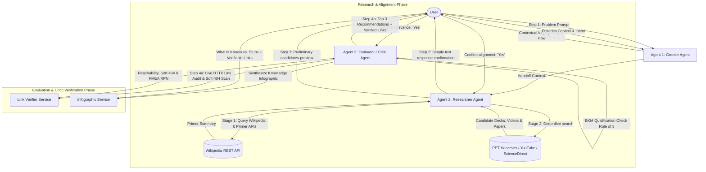
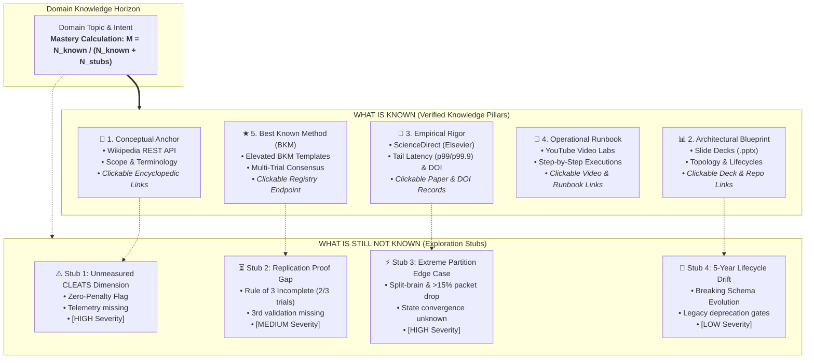
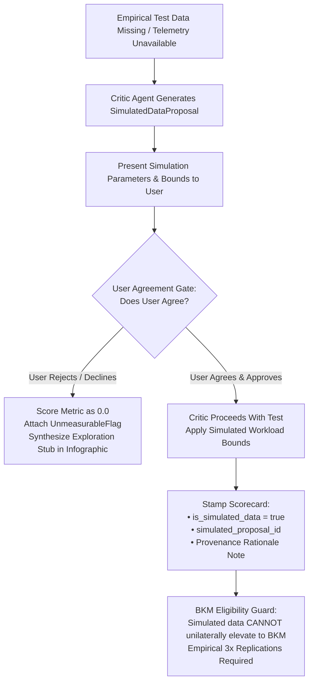

# Explainer: PPT & Video Knowledge System
## Technical Specification (Spec.md)

**Document Version:** 2.0.0  
**Status:** Approved for Implementation & Automated Verification  
**Source Reference:** [Explainer_Overview_v2.docx](file:///c:/Users/Lalit.MSI/Documents/Education/AntiGravity/my_app/Explainer/Explainer_Overview_v2.docx) & [risk_register.csv](file:///c:/Users/Lalit.MSI/Documents/Education/AntiGravity/my_app/Explainer/risk_register.csv)  
**Target Platform:** Web Application & Agentic AI Backend  

---

## Table of Contents
1. [Executive Summary & Objective](#1-executive-summary--objective)
2. [Multi-Agent System Architecture](#2-multi-agent-system-architecture)
   - [2.1 Agent Roles and Responsibilities](#21-agent-roles-and-responsibilities)
   - [2.2 Python Backend Architecture](#22-python-backend-architecture)
   - [2.3 GUI Frontend Architecture](#23-gui-frontend-architecture)
   - [2.4 Client-Server API Contract](#24-client-server-api-contract)
3. [Conversational State Machine & Interaction Flow](#3-conversational-state-machine--interaction-flow)
4. [The CLEATS Evaluation Framework & BKM Protocol](#4-the-cleats-evaluation-framework--bkm-protocol)
   - [4.1 CLEATS Metric Definitions & Scoring Rubric](#41-cleats-metric-definitions--scoring-rubric)
   - [4.2 The Zero-Penalty Rule & Critic Link Gatekeeper](#42-the-zero-penalty-rule-strict-highlight-requirement--critic-link-gatekeeper)
   - [4.3 Best Known Method (BKM) Elevation Protocol](#43-best-known-method-bkm-elevation-protocol)
   - [4.4 Top 3 Ranking Formula](#44-top-3-ranking-formula)
   - [4.5 Mandatory Link Tracking & Source Verification Rule](#45-mandatory-link-tracking--source-verification-rule)
   - [4.6 Knowledge Infographic & Actionable Stubs Framework](#46-knowledge-infographic--actionable-stubs-framework-biowik-aas-wisnk)
   - [4.7 Critic Agent Mandate: "What Must Go Right"](#47-critic-agent-mandate-what-must-go-right-3-circumstances-verification-protocol)
     - [4.7.1 The Five Non-Negotiable Requirements](#471-the-five-non-negotiable-requirements-what-must-go-right)
     - [4.7.2 The 3 Testing Circumstances](#472-the-3-testing-circumstances)
     - [4.7.3 Simulated Test Data Protocol & User Agreement Gate](#473-protocol-for-missing-test-data-simulated-data-proposal--user-agreement-gate)
   - [4.8 Failure Mode and Effects Analysis (FMEA) & RPN Assessment](#48-failure-mode-and-effects-analysis-fmea--risk-priority-number-rpn-assessment)
5. [Technical Data Models & Schemas](#5-technical-data-models--schemas)
6. [Search & Ingestion Specifications](#6-search--ingestion-specifications)
7. [Evaluator Agent Prompting & Scoring Engine](#7-evaluator-agent-prompting--scoring-engine)
8. [User Interface & Presentation Design Guidelines](#8-user-interface--presentation-design-guidelines)
   - [8.1 Greeter & Chat Stream](#81-greeter--chat-stream)
   - [8.2 CLEATS Scorecard Component](#82-cleats-scorecard-component)
   - [8.3 Knowledge Infographic & Stubs UI Dashboard](#83-knowledge-infographic--stubs-ui-dashboard)
   - [8.4 Critic Link Audit Badges & RPN Receipt UI](#84-critic-link-audit-badges--rpn-receipt-ui)
   - [8.5 Simulated Data Proposal & User Agreement Modal](#85-simulated-data-proposal--user-agreement-modal)
9. [Non-Functional & Operational Requirements](#9-non-functional--operational-requirements)
10. [Future Extensibility & Roadmap](#10-future-extensibility--roadmap)
11. [Standardized Output Directory & Artifact Naming Conventions](#11-standardized-output-directory--artifact-naming-conventions)
12. [Pedagogical Framework: Explaining From First Principles to an 8th Grader](#12-pedagogical-framework-explaining-from-first-principles-to-an-8th-grader)

---

## 1. Executive Summary & Objective

The **Explainer** is an intelligent, multi-agent conversational and search system designed to bridge the gap between superficial knowledge and true conceptual mastery. Users frequently ask themselves whether they truly understand a complex domain or problem. 

The Explainer system solves this by:
1. Clarifying the user's specific problem and deep context (intent, motivation, end-use).
2. Grounding the topic with an initial concise conceptual summary (e.g., via Wikipedia REST API) to establish baseline alignment.
3. Conducting deep-dive harvesting of high-bandwidth open-source educational assets—specifically **PowerPoint slide decks (`.ppt`, `.pptx`)**, **educational videos (YouTube)**, and **ScienceDirect (Elsevier)** peer-reviewed scientific literature.
4. Subjecting candidate resources to a standardized **CLEATS** evaluation rubric (Completeness, Latency, Engagement, Accuracy, Transparency, Standardization).
5. Enforcing a strict **Zero-Penalty Rule** for unmeasurable dimensions and establishing **Best Known Method (BKM)** qualification (Rule of 3: 3 people at 3 different times).
6. Requiring the **Critic Agent** to execute live network verification on all candidate URLs, penalizing dead links or soft-404s with Transparency $T = 0.0$ and calculating Failure Mode and Effects Analysis (FMEA) Risk Priority Numbers (RPN).
7. Enforcing the **Simulated Test Data Protocol & User Agreement Gate**: If empirical test data is not available or unmeasurable, the Critic Agent may propose simulated data to be used, and ONLY after explicit user agreement proceed with the test.
8. Presenting the user with the **Top 3 Recommended Resources** complete with detailed CLEATS scorecards, radar visualizations, verified link badges, and actionable rationale.
9. Synthesizing a dynamic **Knowledge Infographic** (`BIOWIK-AAS-WISNK`: *Build an Infographic Of What Is Known And Add Stubs - What Is Still Not Known*) calculating domain mastery percentage.
10. Embedding **Direct Clickable, Verifiable, and Validatable Links** for everything known across all knowledge pillars.
11. Delivering a **First-Principles Pedagogical Mode** ("The Patient Teacher") capable of breaking down complex engineering systems to an 8th-grade level with visually rich slide decks and video storyboards.

---

## 2. Multi-Agent System Architecture

The Explainer operates as a sequential multi-agent pipeline with user-in-the-loop validation checkpoints:



### 2.1 Agent Roles and Responsibilities

| Agent | Responsibility | Core Inputs | Primary Outputs |
| :--- | :--- | :--- | :--- |
| **Agent 1: Greeter** | Greeting, intake problem statement, elicit user motivation and end-use context. | User initial inquiry | Structured problem statement, user motivation, target application |
| **Agent 2: Researcher** | **Stage 1**: Fetch quick baseline summary (Wikipedia).<br>**Stage 2**: Execute deep-dive search for open-source PPTs, YouTube video walkthroughs, and ScienceDirect peer-reviewed literature. | Problem statement & validated scope | (1) Initial primer definition<br>(2) Filtered candidate pool of PPTs, videos & scientific papers |
| **Agent 3: Evaluator / Critic Agent** | **Critic Gatekeeper Duty**: Audits all candidate URLs via concurrent live HTTP HEAD/GET and soft-404 body inspection. Calculates FMEA RPN ($S \times O \times D$). Scores candidate resources against the 6 CLEATS dimensions, zeroes Transparency ($T=0.0$) on dead links, assesses BKM status, ranks Top 3, and synthesizes Knowledge Infographic & Stubs. | Candidate resources + user context | Top 3 recommendations, link audit receipts, CLEATS scorecards, BKM status badges, Knowledge Infographic & exploration stubs |

### 2.2 Python Backend Architecture

The backend is built in **Python (3.11+)** using **FastAPI** as the high-throughput asynchronous API framework, providing both RESTful endpoints and real-time streaming:

```
backend/
├── app.py                          # FastAPI entrypoint, middleware, CORS, and routing
├── config.py                       # Environment configuration & API keys (Pydantic Settings)
├── models/
│   ├── schemas.py                  # Pydantic schemas (Session, CandidateResource, ReferenceLink, CLEATSScorecard, KnowledgeInfographic)
│   └── enums.py                    # ResourceType, AgentState, MetricType, ImpactSeverity
├── agents/
│   ├── orchestrator.py             # Multi-agent state machine and conversation coordinator
│   ├── greeter_agent.py            # Problem intake & motivation context analyzer
│   ├── researcher_agent.py         # Wikipedia primer & deep-dive search dispatcher (PPT, Video, ScienceDirect)
│   └── evaluator_agent.py          # CLEATS scoring engine, Critic link audit & BKM qualification logic (CriticAgent)
├── services/
│   ├── link_verifier.py            # Asynchronous HTTP HEAD/GET link verifier, soft-404 inspector & FMEA RPN engine
│   ├── wikipedia_service.py        # Wikipedia REST API connector & text summarizer
│   ├── ppt_harvester.py            # Slide parser (.pptx via python-pptx, SlideShare/SpeakerDeck scraper)
│   ├── youtube_harvester.py        # YouTube Data API v3 & youtube-transcript-api client
│   ├── sciencedirect_harvester.py  # ScienceDirect / Elsevier peer-reviewed literature & DOI harvester
│   ├── infographic_service.py      # BIOWIK-AAS-WISNK synthesizer: Knowns, Stubs & Verifiable Links
│   └── bkm_service.py              # BKM tracking, triangulation registry (3 people / 3 times)
└── static/                         # Built/served GUI frontend assets
```

### 2.3 GUI Frontend Architecture

The frontend is an **Interactive Graphical User Interface (GUI)** designed with visual excellence, responsive state management, and real-time feedback:

```
frontend/ (GUI)
├── index.html                      # Semantic single-page application shell with stepper, modals & cards
├── css/
│   ├── design_tokens.css           # Color palettes (slate/indigo/amber/emerald), typography, glassmorphism
│   ├── components.css              # Cards, chips, radar charts, modals, badges, verification link pills, audit receipts
│   └── animations.css              # Smooth state transitions, pulse alerts for 0 scores
└── js/
    ├── app.js                      # Main UI state controller, event delegation & infographic renderer
    ├── api_client.js               # Fetch communication with Python FastAPI backend
    ├── components/
    │   ├── stepper.js              # Pipeline progression tracker (Intake -> Primer -> Candidates -> Top 3 / Infographic)
    │   ├── chat_panel.js           # Conversational stream with intent chips
    │   ├── primer_card.js          # Wikipedia summary preview with 1-click confirmation
    │   ├── candidate_grid.js       # Slide deck, video, and ScienceDirect paper previews with toggles
    │   └── cleats_dashboard.js     # Top 3 podium, CLEATS score visualizer, Zero pills, BKM badge, and Verification Links
    └── charts/
        └── cleats_radar.js         # Canvas/SVG 6-axis CLEATS radar visualization
```

### 2.4 Client-Server API Contract

| Method | Endpoint | Request Payload | Response Payload | Description |
| :--- | :--- | :--- | :--- | :--- |
| `POST` | `/api/session/start` | `{}` | `{ "sessionId": "...", "state": "INTAKE", "greeting": "..." }` | Initializes new session and greets user |
| `POST` | `/api/chat/intake` | `{ "sessionId": "...", "problem": "...", "intent": "..." }` | `{ "sessionId": "...", "state": "BASELINE", "primer": { ... } }` | Intakes problem & context, returns Wikipedia primer |
| `POST` | `/api/chat/confirm-primer` | `{ "sessionId": "...", "confirmed": true, "refinement": null }` | `{ "sessionId": "...", "state": "DEEP_DIVE", "candidates": [...] }` | User confirms primer; triggers PPT, video & ScienceDirect harvesting |
| `POST` | `/api/chat/confirm-candidates` | `{ "sessionId": "...", "selectedIds": ["c1", "c3"] }` | `{ "sessionId": "...", "state": "RECOMMENDATION", "top3": [...], "infographic": { ... } }` | Confirms candidate relevance; triggers Critic link audit, CLEATS evaluation & infographic |
| `GET` | `/api/link/verify` | `?url=...` | `{ "url": "...", "verifiable": true, "status_code": 200, "rpn": 0, "tell_tale_signs": "..." }` | Live HTTP reachability check, soft-404 body scan & FMEA RPN scoring |
| `POST` | `/api/link/verify-batch` | `{ "urls": ["...", "..."] }` | `[{ "url": "...", "verifiable": true, ... }]` | Concurrently audits multiple URLs with FMEA RPN diagnostics |
| `POST` | `/api/critic/simulated-data/propose` | `{ "sessionId": "...", "candidateId": "...", "missingReason": "..." }` | `SimulatedDataProposal` | Critic generates proposed simulated test data when empirical test data is missing |
| `POST` | `/api/critic/simulated-data/confirm` | `{ "proposalId": "...", "userAgreed": true }` | `{ "status": "APPROVED", "proceedWithTest": true }` | User agreement gate: user approves/rejects testing with simulated data |
| `GET` | `/api/session/{id}` | `None` | `ExplainerSession` | Returns current session snapshot & scorecards |
| `GET` | `/api/session/{id}/infographic` | `None` | `KnowledgeInfographic` | Synthesizes session knowledge infographic with knowns, stubs & links |
| `GET` | `/api/infographic/topic/{topic}` | `None` | `KnowledgeInfographic` | Generates on-demand knowledge infographic and exploration stubs for any topic |
| `GET` | `/api/bkm/registry` | `None` | `{ "bkmTemplates": [...] }` | Returns catalog of elevated Best Known Methods |

---

## 3. Conversational State Machine & Interaction Flow

```
[State 0: IDLE / GREETING]
       │
       ▼
[State 1: INTAKE_PROBLEM]
       │ Prompt: "What is the problem or area of focus that you want the explainer to search and get?"
       ▼
[State 2: ELICIT_CONTEXT]
       │ Prompt: "Why do you want to know about this topic, and what will you use this understanding for?"
       ▼
[State 3: BASELINE_ALIGNMENT]
       │ Action: Fetch Wikipedia/Encyclopedia primer summary.
       │ Prompt: "Here is a quick summary of [Topic]. Is this what you are interested in learning about? (Yes/Refine)"
       ├── User replies "Refine" ──► Loop back to State 1 or State 2
       │
       ▼ (User confirms "Yes")
[State 4: DEEP_DIVE_SEARCH]
       │ Action: Search open-source PPTs, Slideshare, SpeakerDeck, YouTube lectures, ScienceDirect papers.
       │ Action: Present candidate list (titles, types, sources, clickable links).
       │ Prompt: "We identified [N] slide decks, video resources, and scientific papers. Do these match what you're looking for?"
       │
       ▼ (User confirms "Yes")
[State 5: CRITIC_AUDIT_AND_CLEATS_EVALUATION]
       │ Action: Critic Agent performs concurrent async HTTP HEAD/GET audit on all candidate URLs and reference arrays.
       │ Action: Inspect response payloads for soft-404 banners ("not found", "removed") with GET fallback.
       │ Action: Calculate FMEA Risk Priority Numbers (RPN = S x O x D) and identify tell-tale signs.
       │ Action: If any URL fails reachability, score Transparency T = 0.0 under the Zero-Penalty Rule.
       │
       ├── Missing Empirical Test Data? ──► [State 5b: SIMULATED_DATA_PROPOSAL_GATE]
       │                                          │ Action: Critic proposes synthetic test fixtures & scenario
       │                                          │ Prompt: "Empirical test data is missing for [metric].
       │                                          │          Critic proposes simulated dataset [P]. Do you agree?"
       │                                          ├── User Declines: Score as 0.0, generate Exploration Stub
       │                                          └── User Agrees: Attach provenance tag, proceed with test
       │
       ▼
       │ Action: Score CLEATS dimensions with user-approved simulated data or empirical metrics.
       │ Action: Check BKM qualification criteria (Rule of 3: 3 practitioners x 3 times).
       ▼
[State 6: RECOMMENDATION_PRESENTATION]
       │ Output: Top 3 recommendations with verified link badges, visual scorecards, highlights for zeros, and BKM tags.
       ▼
[State 7: POST_ANALYSIS_INTERACTION]
       └─► User can inspect full metrics, review Critic audit receipts, explore Knowledge Infographic stubs, or export study plan.
```

---

## 4. The CLEATS Evaluation Framework & BKM Protocol

Every located resource is rigorously evaluated across six dimensions on a discrete scale from **1 to 10** (10 being the highest possible quality).

### 4.1 CLEATS Metric Definitions & Scoring Rubric

```
  C ── Completeness      (Scope & depth of solution)
  L ── Latency           (Time & cognitive load to complete answer)
  E ── Engagement        (Authority, expert consensus, contributor breadth)
  A ── Accuracy          (Factual relevance, competitiveness, technical validity)
  T ── Transparency      (Documented, auditable, reproducible methodology)
  S ── Standardization   (Industry/organizational adoption, published BKM)
```

#### 1. C – Completeness
* **Definition:** How comprehensively does the source address the user's specific problem and context?
* **Scoring Rubric (1–10):**
  * `1–3`: Superficial overview, leaves major questions unanswered, high prerequisite gap.
  * `4–7`: Covers primary facets of the question, but skips edge cases, architecture, or nuance.
  * `8–10`: Exhaustive, end-to-end explanation addressing underlying principles, practical application, and user context.

#### 2. L – Latency
* **Definition:** How long will it take the user to get the complete answer? Represents cognitive throughput and time efficiency (e.g., slide length, video runtime vs. information density).
* **Scoring Rubric (1–10):**
  * `1–3`: Extremely high latency; bloated 2-hour recording with low signal-to-noise ratio or rambling 100-slide deck.
  * `4–7`: Moderate latency; well-paced 20–30 minute video or 30-slide deck with structured sections.
  * `8–10`: Optimal latency; rapid time-to-insight (e.g., a crisp 10-slide high-density executive deck or an indexed 8-minute technical walkthrough with timestamped chapters).

#### 3. E – Engagement
* **Definition:** Has the person or source that answered the question proven truly knowledgeable? Have key contributors and authoritative experts in the domain been engaged, and are their responses captured?
* **Scoring Rubric (1–10):**
  * `1–3`: Unknown or anonymous author; single isolated viewpoint with no peer review or community validation.
  * `4–7`: Industry practitioner or reputable creator; incorporates standard citations or common industry consensus.
  * `8–10`: Recognized domain authority / core contributor / principal architect; incorporates multi-stakeholder perspectives and consensus from leading experts.

#### 4. A – Accuracy
* **Definition:** Is the technical accuracy of the answer relevant, up-to-date, competitive, and verified against modern standards?
* **Scoring Rubric (1–10):**
  * `1–3`: Outdated, deprecated methodologies, factually misleading or incorrect terminology.
  * `4–7`: Factually sound for standard setups; minor gaps in current year competitiveness or minor version lag.
  * `8–10`: Flawlessly accurate, aligned with modern state-of-the-art standards and peer-verified benchmarks.

#### 5. T – Transparency
* **Definition:** Is the method for obtaining answers known, captured, recorded, and available for training and validation by duplicating the method?
* **Scoring Rubric (1–10):**
  * `0.0`: **MANDATORY CRITIC ZERO-PENALTY:** Assigned immediately if any reference or source link is dead (HTTP 404, DNS resolution error) or returns a masked soft-404 payload ("presentation not found", "removed"). Permanently disqualifies candidate from BKM elevation.
  * `1–3`: Black-box assertions; conclusions presented with no underlying data, steps, or source artifacts.
  * `4–7`: Methodology is partially documented; steps are described conceptually but require inferred gaps to duplicate.
  * `8–10`: Fully transparent; step-by-step reproduction guide, references, raw data, or runbooks are open, auditable, and all attached links are verified 100% active by the Critic Agent.

#### 6. S – Standardization
* **Definition:** Is the method for producing the answer consistently used by all members in the same group, organization, or industry? Is it published in an authoritative venue?
* **Scoring Rubric (1–10):**
  * `1–3`: Ad-hoc, idiosyncratic personal recipe not recognized outside the author's personal workflow.
  * `4–7`: Emerging pattern adopted by some teams; semi-formal internal standard or popular blog convention.
  * `8–10`: Published industry standard (e.g., RFC, ISO, official vendor architecture guide, widely recognized BKM).

---

### 4.2 The Zero-Penalty Rule (Strict Highlight Requirement) & Critic Link Gatekeeper

> [!CAUTION]
> **Strict Rule for Unmeasurable Metrics & Broken Links:**
> If any of the 6 CLEATS metrics cannot be verified or measured from the source material or author metadata, that metric **MUST be scored as ZERO (0)**.
>
> 1. **Critic Link Gatekeeping:** The Critic (Evaluator Agent) **must always verify and check all reference links** via HTTP HEAD/GET before publishing candidate recommendations.
> 2. **Transparency Penalty:** If any reference or source link is dead, invalid, or produces a 404, **Transparency (T) is immediately scored as ZERO (0.0)**.
> 3. Any metric assigned a `0` **must be visually highlighted** (e.g., bright badge / amber alert) in the UI.
> 4. The rationale for why the metric was unmeasurable must be explicitly stated.
> 5. **Disqualification:** A score of `0` in *any* dimension strictly disqualifies the source from being elevated to a Best Known Method (BKM) and gates it from top recommendations.

---

### 4.3 Best Known Method (BKM) Elevation Protocol

The system maintains a formal qualification criteria for designating a source or method as a **BKM**:

```
                       ┌──────────────────────────────────────────────┐
                       │           Candidate Resource Scored          │
                       └──────────────────────┬───────────────────────┘
                                              │
                                              ▼
                                 ┌─────────────────────────┐
                                 │ Any CLEATS metric == 0? │
                                 └────────────┬────────────┘
                                        YES   │    NO
                        ┌─────────────────────┘    └──────────────────────┐
                        ▼                                                 ▼
             ┌─────────────────────┐                          ┌───────────────────────────┐
             │ BKM Disqualified    │                          │ Check Empirical Stability:│
             │ (Zeros cannot       │                          │ Has method been applied   │
             │  contribute to BKM) │                          │ by 3 people at 3 times    │
             └─────────────────────┘                          │ producing expected results?
                                                              └─────────────┬─────────────┘
                                                                     YES    │    NO
                                                     ┌──────────────────────┘    └──────────────────────┐
                                                     ▼                                                  ▼
                                      ┌───────────────────────────────┐                  ┌──────────────────────────────┐
                                      │ ELEVATE TO BKM:               │                  │ Standard Candidate:          │
                                      │ Designated Best Known Method  │                  │ Strong resource, but lacks   │
                                      │ Template for future reuse     │                  │ 3x validation proof          │
                                      └───────────────────────────────┘                  └──────────────────────────────┘
```

**BKM Elevation Threshold Criteria:**
1. **Zero-Free:** Zero scores across all 6 dimensions ($C > 0, L > 0, E > 0, A > 0, T > 0, S > 0$).
2. **Empirical Triangulation:** Evidence that **3 distinct practitioners** at **3 distinct times** have applied the method and produced outcomes consistent with the method's predicted expectations.
3. **Template Readiness:** Clear, reproducible steps that can serve as an organization-wide or community-wide template for future inquiries.

---

### 4.4 Top 3 Ranking Formula

To select the Top 3 items out of all validated candidates, the Evaluator calculates a composite **CLEATS Score** ($S_{\text{CLEATS}}$):

$$S_{\text{CLEATS}} = \left( w_C \cdot C + w_L \cdot L + w_E \cdot E + w_A \cdot A + w_T \cdot T + w_S \cdot S \right) \times \Phi_{\text{zero\_penalty}}$$

Where:
* Default normalized weights: $w_C = 0.25, w_A = 0.25, w_L = 0.15, w_T = 0.15, w_E = 0.10, w_S = 0.10$ (customizable based on user's target application).
* **Zero Penalty Multiplier ($\Phi$):**
  $$\Phi_{\text{zero\_penalty}} = \begin{cases} 1.0 & \text{if all metrics } > 0 \\ 0.65 & \text{if 1 metric } = 0 \\ 0.30 & \text{if } \ge 2 \text{ metrics } = 0 \end{cases}$$
* Candidates with zero scores are penalized in ranking to ensure high-transparency, fully-measurable resources surface to the Top 3.

---

### 4.5 Mandatory Link Tracking & Source Verification Rule

> [!IMPORTANT]
> **Link Tracking & Verification Requirement:**
> The system must continuously track direct URLs for all discovered and recommended resources across four distinct categories:
> 1. **Document Links (`document_url`):** Direct links to `.pptx`, `.ppt`, `.pdf`, SlideShare, or SpeakerDeck presentations.
> 2. **Website Links (`website_url`):** Supporting project documentation, official specifications, GitHub repositories, or vendor guides.
> 3. **YouTube Video Links (`video_url`):** Video walkthroughs, conference recordings, and timestamped lectures.
> 4. **Scientific Paper & DOI Links (`doi`, `primary_url`):** ScienceDirect manuscripts, publisher citation records, and `https://doi.org/...` identifiers.
>
> **Always Display Links in Recommendations & Infographics:**
> In all candidate views, CLEATS scorecards, Knowledge Infographics, and exported reports, the system **MUST always prominently display clickable links** with clear URL domain badges and one-click "Copy URL" functionality so users can immediately validate, audit, and inspect the underlying materials.

---

### 4.6 Knowledge Infographic & Actionable Stubs Framework (`BIOWIK-AAS-WISNK`)

The system synthesizes a comprehensive Knowledge Infographic with explicit boundary mapping:



#### 4.6.1 Knowledge Mastery Metric
Conceptual domain mastery is quantitatively derived as the proportion of verified knowledge pillars against the total active knowledge horizon (verified pillars + open stubs):

$$M_{\text{domain}} = \left( \frac{N_{\text{measured\_pillars}}}{N_{\text{measured\_pillars}} + N_{\text{open\_stubs}}} \right) \times 100\%$$

#### 4.6.2 Knowledge Stub Anatomy
Each exploration stub enforces a strict operational contract:
* **Unique Identifier (`id`):** e.g., `stub_zero_standardization`, `stub_replication_gap`.
* **Category:** Classification of the knowledge gap.
* **Impact Severity:** `HIGH` (blocks production safety), `MEDIUM` (blocks formal BKM elevation), or `LOW` (long-term lifecycle debt).
* **Gap Description:** Explicit articulation of what is *not* known.
* **Suggested Action:** Actionable technical recommendation to close the gap.
* **Inquiry Prompt:** Pre-engineered, copy-paste ready prompt allowing the user to immediately trigger an agentic deep dive on the open stub.

---

### 4.7 Critic Agent Mandate: "What Must Go Right" (3 Circumstances Verification Protocol)

The **Critic Agent (`EvaluatorAgent` / `CriticAgent`)** acts as the definitive gatekeeper of empirical truth, transparency, and link reachability before any candidate resource, architectural blueprint, or Best Known Method (BKM) is published to end users.

#### 4.7.1 The Five Non-Negotiable Requirements ("What Must Go Right")

1. **Pre-Publication Active Link Verification:**
   - The Critic MUST actively probe and verify every URL attached to a candidate resource (`url`, `document_url`, `website_url`, `video_url`, and all entries in `reference_links`) using concurrent asynchronous HTTP HEAD/GET handshakes prior to CLEATS scoring and ranking.
   - Pure string syntax checking is strictly prohibited; the network endpoint must resolve and return a valid HTTP response code.
2. **Strict CLEATS Zero-Penalty Enforcement:**
   - If any URL fails reachability (HTTP 404, DNS resolution error, socket drop, or soft-404 payload), **Transparency ($T$) MUST be assigned a strict score of `0.0`**.
   - Under the CLEATS Zero-Penalty Rule:
     $$\text{Any Metric } = 0.0 \implies \text{Strictly Disqualified from Best Known Method (BKM) Elevation}$$
     *"ZEROS cannot contribute to BKMs."*
3. **Publication Gatekeeping & Rank Isolation:**
   - Resources failing link audits must NEVER be published in the Top 3 recommendations if verified alternatives exist.
   - Any resource failing link audits is explicitly flagged with `critic_verified = False` and detailed audit diagnostic notes.
4. **Triangulated Empirical Replication (Rule of 3):**
   - For an architectural pattern or method to be designated as an official BKM template, it must possess empirical evidence of **3 distinct practitioners at 3 distinct time windows** duplicating the procedure with zero error spikes.
5. **Simulated Test Data Protocol & User Agreement Gate:**
   - If empirical test data (telemetry, live replication traces, benchmark metrics, or candidate slide decks) is **not available or unmeasurable**:
     - The Critic Agent **MAY propose simulated data / synthetic test fixtures** to be used.
     - **MANDATORY GATE:** The Critic MUST NEVER execute tests on simulated data unilaterally. The Critic must present the simulated dataset proposal (scope, generation methodology, parameter bounds, and rationale) to the user.
     - **ONLY after explicit user agreement / consent** may the Critic proceed with the test.
     - Once approved by the user, the test proceeds with transparent simulated provenance tagging (`provenance: "SIMULATED_DATA"`, `user_agreed: true`).
     - **Integrity Rule:** Simulated data CANNOT unilaterally elevate a candidate to an official Best Known Method (BKM); BKM elevation strictly requires 3 real-world empirical replications.

#### 4.7.2 The 3 Testing Circumstances

To guarantee operational compliance, the Critic Agent is evaluated across **3 distinct circumstances**:

| Circumstance | Description | Input Conditions | Expected Critic Behavior & CLEATS Impact |
| :--- | :--- | :--- | :--- |
| **Circumstance 1** | **All Links 100% Active & Reachable** | Candidate with valid, active presentation, video, and paper URLs returning HTTP 200/30x. | • All links marked `is_verified = True`<br>• Transparency ($T \ge 8.5$)<br>• Zero unmeasurable flags<br>• BKM-eligible and published as Rank #1<br>• Residual RPN = 0 |
| **Circumstance 2** | **Subtle Deep Broken Link in Reference Array** | Candidate whose primary URL resolves, but a secondary `document_url` or nested `reference_links` item returns 404/DNS error. | • Critic catches nested dead link<br>• Candidate flagged `critic_verified = False`<br>• Transparency zeroed ($T = 0.0$)<br>• Disqualified from BKM elevation<br>• Gated from Top #1 recommendation (RPN = 336) |
| **Circumstance 3** | **Bot-Shielded Institutional Domain & Soft-404 Masking** | Candidate with Cloudflare-protected publisher paper (HTTP 403) and another returning HTTP 200 but page body contains "Presentation removed". | • Critic recognizes institutional bot-shielding (401/403) as valid active publishers without penalizing<br>• Critic performs body scan detecting soft-404 string<br>• Maximum detectability penalty ($D \to 10$, RPN = 315) applied to soft-404 with $T = 0.0$ |

#### 4.7.3 Protocol for Missing Test Data: Simulated Data Proposal & User Agreement Gate

When empirical data (production traces, field telemetry, live load tests, or candidate assets) is unavailable, the Critic Agent enforces a formal **User Agreement Gate**:



**Key Operational Rules:**
1. **Unilateral Testing Prohibition:** The Critic Agent is strictly forbidden from executing tests or calculating scores on synthetic/simulated data without verified user consent. Calling `evaluate_resource()` with unapproved simulated data throws a hard `PermissionError`.
2. **Transparent Provenance Stamping:** If the user agrees, the resulting scorecard and UI display prominent simulated provenance indicators (`is_simulated_data: true`, `simulated_proposal_id`), ensuring synthetic data is never disguised as ground truth.
3. **BKM Isolation:** A candidate evaluated on simulated data cannot be elevated to an official Best Known Method (BKM). Elevation to BKM strictly requires documented proof of 3 replications by 3 distinct practitioners at 3 distinct time windows under production conditions.

---

### 4.8 Failure Mode and Effects Analysis (FMEA) & Risk Priority Number (RPN) Assessment

The Critic Agent actively assesses **"What can go wrong?"** using standard engineering FMEA protocols to calculate the **Risk Priority Number (RPN)**:

$$\text{RPN} = \text{Severity } (S) \times \text{Occurrence } (O) \times \text{Detectability } (D)$$

Where:
* **Severity ($S$, 1–10):** Measures the worst-case real-world damage in **financial loss ($)** and **project delay (time)**.
* **Occurrence ($O$, 1–10):** Frequency/probability of the failure mode occurring without active Critic gatekeeping.
* **Detectability ($D$, 1–10):** **Inverse detectability score**. **Critical Rule: If risk triggers are silent or not detectable before user impact, the lack of detectability receives a higher score ($D \to 10$)**.

#### Comprehensive Critic FMEA Risk Assessment Matrix

> **Active Risk Registry Artifact:** This matrix is exportable and maintained in machine-readable format at [`risk_register.csv`](file:///c:/Users/Lalit.MSI/Documents/Education/AntiGravity/my_app/Explainer/risk_register.csv).

| Risk ID | Failure Mode (What can go wrong?) | Worst That Can Happen (Realized Risk) | Impact in $ & Time (Severity $S$) | Probability ($O$) | How Risk Becomes Visible (Tell-Tale Signs) | Lack of Detectability ($D$) | RPN ($S \times O \times D$) | Critic Countermeasure & Verification Gate |
| :---: | :--- | :--- | :--- | :---: | :--- | :---: | :---: | :--- |
| **RSK-01** | **Hallucinated / Synthetic Dead URLs**<br>AI/Harvester generates fictitious file paths (e.g. `/cable-manufacturing-should-cost-model-architecture-deepdive.pptx`). | Executive or procurement engineer attempts to verify should-cost calculations in high-stakes vendor negotiation; link 404s. Model cannot be defended; vendor overcharges or contract collapses. | **$500,000 – $1,500,000** procurement loss; **8–12 weeks** renegotiation slip.<br>($S = 8$) | **6** (Frequent in generative workflows without live web checks) | User browser renders 404 page; browser network log records HTTP 404; user reports dead reference link. | **7** (Syntactically looks like a valid `.pptx` URL; completely invisible without live HTTP handshake) | **336** | **Mandatory Active Probe:** Critic executes live HTTP HEAD/GET handshake on all candidate URLs before ranking. |
| **RSK-02** | **Soft-404 & Content Removal Masking**<br>Host server returns HTTP 200 OK, but page body contains "Item has been removed", "Slide not found", or generic portal home. | Engineering team relies on "verified" BKM template during an emergency infrastructure migration; link lands on a deleted asset page during a live outage. | **$100,000 – $450,000** production downtime; **24–72 hours** emergency remediation.<br>($S = 7$) | **5** (Common on legacy deck-sharing platforms) | Browser displays "Presentation removed"; page title is generic login/404; Content-Length < 1.5 KB. | **9** (Extremely hard to detect via HTTP status code alone since status is 200 OK) | **315** | **Body Content Inspection:** Critic scans response HTML for soft-404 strings ("not found", "removed", "no longer available") and validates payload size. |
| **RSK-03** | **Bot-Shield False Negative (Cloudflare 403 on Elsevier/ScienceDirect)**<br>Automated scraper receives 403 Forbidden from publisher bot defense; Critic mistakes it for dead paper. | Ground-truth peer-reviewed empirical benchmarks are falsely disqualified; team adopts an unverified amateur blog instead, introducing latent architectural bugs. | **$250,000 – $1,000,000** in architectural rework and technical debt; **3–5 months** delayed feature rollout.<br>($S = 8$) | **7** (Elsevier/ScienceDirect aggressively challenge automated bots) | Programmatic client gets 403; response contains `CF-RAY` or `server: cloudflare`; link opens perfectly in human browser. | **4** (Status 403 is immediately visible in logs, but easily misclassified as dead) | **224** | **Domain & DOI Verification:** Critic recognizes protected publisher domains and verifies academic papers via Crossref REST API and DOI resolution (`https://doi.org/...`). |
| **RSK-04** | **Domain Expiry & Malicious Redirect**<br>Author domain expires; domain squatter redirects traffic to spam or malicious payload. | Enterprise user clicks "verified" link in the Explainer tool, leading to credential theft, malware drive-by, or infosec compliance audit violation. | **$1,000,000 – $5,000,000** security breach remediation, forensic investigation, and audit penalties; **6+ months** remediation.<br>($S = 9$) | **2** (Rare for curated top-tier repositories, but high risk over time) | Destination URL hostname changes abruptly (e.g. `tech-example.org` redirects to `spam-casino.xyz`); SSL cert domain mismatch. | **8** (Redirect chain returns 200 at destination; requires domain shift tracking) | **144** | **Redirect Shift Detection:** Critic tracks redirect chains (`r.url.host`) and flags cross-domain redirection to untrusted domains. |
| **RSK-05** | **Unconsented Simulated Data Drift**<br>Critic runs evaluations on synthetic data without user consent; results diverge from customer operational reality. | Engineering decisions committed based on synthetic assumptions; production system fails under live stress because simulated inputs did not mirror production edge cases. | **$200,000 – $600,000** architectural rework; **4–8 weeks** unplanned redesign.<br>($S = 6$) | **5** (Common when benchmark data is unavailable) | Telemetry shows synthetic distribution markers; discrepancies between lab benchmarks and field telemetry; unflagged synthetic provenance. | **8** (Synthetic data appears statistically clean and valid unless provenance is audited) | **240** | **Mandatory User Agreement Gate:** Critic must formally present simulated data proposal and await explicit user agreement before testing. |

---

## 5. Technical Data Models & Schemas

### 5.1 User Interaction State

```typescript
interface ExplainerSession {
  sessionId: string;
  timestamp: string;
  state: 'INTAKE' | 'CONTEXT' | 'BASELINE' | 'DEEP_DIVE' | 'EVALUATION' | 'RECOMMENDATION';
  userQuery: {
    rawProblem: string;          // "What is the problem or area of focus..."
    intentContext?: string;      // "Why does user want to know..."
    applicationContext?: string; // "...what will they use that understanding for"
  };
  baselinePrimer?: {
    source: string;              // e.g. "Wikipedia"
    summaryText: string;
    confirmedByCustomer: boolean;
  };
  candidatePool: CandidateResource[];
  evaluatedResources: EvaluatedResource[];
  top3Recommendations: EvaluatedResource[];
}
```

### 5.2 Candidate & Evaluated Resource

```typescript
type ResourceType = 'PPT_DECK' | 'YOUTUBE_VIDEO' | 'SCIENTIFIC_PAPER' | 'ONLINE_DOCUMENT';

interface ReferenceLink {
  title: string;
  url: string;
  type: 'document' | 'website' | 'video' | 'paper';
  description?: string;
  is_verified: boolean;                 // Set by Critic Agent active probe (HTTP 200/30x/403)
  http_status?: number;                 // e.g. 200, 301, 403
  verification_message?: string;        // e.g. "Critic Verified Active (HTTP 200)"
}

interface CandidateResource {
  id: string;
  title: string;
  url: string;                          // Primary access URL
  document_url?: string;                // Direct link to presentation/document
  website_url?: string;                 // Supporting site, repo, or docs
  video_url?: string;                   // Video explanation/talk
  doi?: string;                         // Digital Object Identifier (ScienceDirect)
  journal?: string;                     // Journal name (e.g. Journal of Systems Architecture)
  citation_count?: number;              // Verified citation count
  reference_links: ReferenceLink[];     // Full list of tracked verification links
  type: ResourceType;
  source: string;
  author_or_channel: string;
  publicationDate?: string;
  snippet: string;
  slide_count?: number;                 // for PPT
  video_duration?: string;              // formatted duration e.g. "18:42"
  video_duration_seconds?: number;      // for YouTube
  tags: string[];
  critic_verified: boolean;             // True if all candidate URLs passed Critic audit
  critic_audit_notes?: string;          // Audit receipt notes from Critic verification
  scorecard?: CLEATSScorecard;
  rank?: number;                        // 1, 2, 3...
  isUserConfirmedRelevant: boolean;
}

interface LinkVerificationResult {
  url: string;
  verifiable: boolean;
  status_code: number;
  reason: string;
  rpn: number;                          // Severity x Occurrence x Detectability (RPN)
  severity: number;                     // 1-10 ($ impact and time delay)
  occurrence: number;                   // 1-10 (probability of event)
  detectability: number;                // 1-10 (higher score for silent/undetectable risks)
  tell_tale_signs: string;              // Diagnostic indicators of realized risk
}

interface SimulatedDataProposal {
  proposalId: string;
  topic: string;
  candidateId: string;
  missingDataDescription: string;       // e.g. "Missing empirical p99 latency under 10k QPS"
  simulatedScenario: string;            // Description of simulated benchmark
  syntheticMetrics: {
    workloadDistribution: string;      // e.g. "Poisson arrival with 10k req/s"
    sampleSize: number;                 // e.g. 100,000 synthetic requests
    simulatedLatencyP99Ms?: number;     // e.g. 12.4ms
    simulatedErrorRate?: number;        // e.g. 0.0001
  };
  rationale: string;                    // Why simulated data is valid for provisional evaluation
  userAgreed: boolean;                  // Mandatory user consent gate
  status: 'PENDING_USER_AGREEMENT' | 'USER_APPROVED' | 'USER_REJECTED';
}

interface CLEATSScorecard {
  completeness: number;          // 0 to 10
  latency: number;               // 0 to 10
  engagement: number;            // 0 to 10
  accuracy: number;              // 0 to 10
  transparency: number;          // 0 to 10 (0.0 if any link fails Critic audit)
  standardization: number;       // 0 to 10
  isSimulatedData?: boolean;     // True if evaluated using user-approved simulated data
  simulatedProposalId?: string;  // Traceback to user agreement proposal
  unmeasurableFlags: {
    metric: 'C' | 'L' | 'E' | 'A' | 'T' | 'S';
    reason: string;
  }[];
  compositeScore: number;        // Weighted 0.0 - 10.0 (penalized by zero multiplier)
  bkmStatus: {
    isBkmEligible: boolean;      // Strictly false if any metric is 0 or simulated data lacks empirical replication
    isElevatedBkm: boolean;
    disqualificationReason?: string; // Set if any metric is 0 or links failed audit
    triangulationEvidence?: string;  // 3 people / 3 times validation notes
  };
  scoringRationale: {
    completenessNote: string;
    latencyNote: string;
    engagementNote: string;
    accuracyNote: string;
    transparencyNote: string;
    standardizationNote: string;
  };
}

interface EvaluatedResource extends CandidateResource {
  scorecard: CLEATSScorecard;
  rank: number; // 1, 2, 3...
}
```

### 5.3 Knowledge Infographic & Stubs Data Models

```typescript
interface KnownEntity {
  category: string;                     // e.g. "Conceptual Anchor", "Architectural Blueprint"
  title: string;
  detail: string;
  confidence: number;                   // 1.0 to 10.0
  primary_url?: string;                 // Direct primary verifiable link
  sources: string[];
  reference_links: ReferenceLink[];     // Verifiable links with badges & copy functionality
  status: 'VERIFIED' | 'CONSENSUS' | 'HIGH_CONFIDENCE';
  icon: string;
}

interface UnknownStub {
  id: string;
  category: string;
  title: string;
  gap_description: string;
  suggested_action: string;
  inquiry_prompt: string;               // Copy-paste ready investigation prompt
  impact_severity: 'HIGH' | 'MEDIUM' | 'LOW';
  related_dimension?: string;           // C, L, E, A, T, or S
  icon: string;
}

interface KnowledgeInfographic {
  topic: string;
  summary: string;
  mastery_percentage: number;           // e.g. 55.6%
  measured_dimensions_count: number;
  unmeasured_stubs_count: number;
  bkm_elevation_progress: string;       // e.g. "Candidate Tier (2/3 Replications Verified)"
  known_items: KnownEntity[];
  unknown_stubs: UnknownStub[];
}
```

---

## 6. Search & Ingestion Specifications

### 6.1 Baseline Primer Ingestion (Wikipedia API)
* **Endpoint:** `https://en.wikipedia.org/api/rest_v1/page/summary/{topic}`
* **Fallback:** DuckDuckGo Instant Answer API / Wikipedia OpenSearch.
* **Extraction:** Extract leading 2–3 sentences defining core concepts, key mechanisms, and industry jargon.
* **Verification Prompt:** Display concise text to user with a 1-click **"Confirm & Deep Dive"** or **"Refine Topic"** action.

### 6.2 PPT & Slide Deck Harvester
* **Search Targets:**
  * Google Search / Bing Search with queries:
    * `"{topic}" filetype:ppt OR filetype:pptx`
    * `site:slideshare.net "{topic}"`
    * `site:speakerdeck.com "{topic}"`
    * `site:github.com "{topic}" filename:*.pptx`
    * `site:edu "{topic}" filetype:pptx`
* **Parsing & Extraction:**
  * Extract slide count, slide titles, speaker notes, and deck text using `python-pptx` or doc conversion tools.
  * Estimate cognitive latency: $\approx 1.5\text{ minutes per technical slide}$.

### 6.3 YouTube & Video Harvester
* **Search Targets:**
  * YouTube Data API v3 (`search?part=snippet&type=video&videoCaption=closedCaption&q={topic}`).
* **Parsing & Extraction:**
  * Filter for high-retention instructional formats: tech talks, conference keynotes (e.g., PyCon, AWS re:Invent, IEEE), university lectures.
  * Ingest auto-generated or manual subtitles/transcripts via `youtube-transcript-api`.
  * Calculate duration latency: extract duration in seconds and chapter timestamps.

### 6.4 ScienceDirect (Elsevier) Literature & DOI Harvester
* **Search Targets:**
  * ScienceDirect Search API & Elsevier Scopus Indexing:
    * Peer-reviewed computer systems, architecture, and engineering literature.
    * Target journals: *Journal of Systems Architecture*, *Future Generation Computer Systems*, *Journal of Network and Computer Applications*.
* **Parsing & Metadata Extraction:**
  * Extract permanent digital object identifier (e.g., `https://doi.org/10.1016/...`).
  * Extract citation count, journal impact indicators, publication year, and author affiliations.
  * Ingest empirical benchmark sections (e.g., throughput degradation curves, p99/p99.9 tail latencies).
  * Generate permanent verification link entries with badge type `paper` / `🔬 DOI`.

---

## 7. Evaluator Agent Prompting & Scoring Engine

The Evaluator Agent consumes the user's intent context and the candidate resource transcript/slide content to compute reproducible scores.

```json
{
  "system_instruction": "You are the CLEATS Evaluator Agent. Analyze the supplied resource against user context. Score each of the 6 dimensions from 1 to 10. CRITICAL: If any metric is missing, unverifiable, or not measurable from the material, score it STRICTLY as 0 and record the metric in unmeasurableFlags. Any score of 0 permanently disqualifies the resource from BKM status.",
  "input_parameters": {
    "user_problem": "...",
    "user_intent_and_application": "...",
    "resource_metadata": "...",
    "extracted_content_sample": "..."
  },
  "expected_output_format": "JSON matching CLEATSScorecard schema"
}
```

---

## 8. User Interface & Presentation Design Guidelines

To align with modern web design principles and showcase the CLEATS results clearly:

### 8.1 Greeter & Chat Stream
* Sleek conversational interface with step-by-step progress indicator:
  1. **Topic & Context** ➔ 2. **Primer Alignment** ➔ 3. **Candidate Validation** ➔ 4. **CLEATS Top 3**
* Input cards featuring quick-chips for common intents ("Work Architecture Review", "Exam Prep", "Executive Briefing").

### 8.2 CLEATS Scorecard Component
Each of the Top 3 recommended items is rendered with:
* **Resource Type Badge:** Distinctive styling for `PPT Deck`, `YouTube Video`, and `ScienceDirect Paper`.
* **Hexagonal or Bar Radar Chart:** Visual representation of the 6 CLEATS metrics.
* **Zero-Score Warning Pill:** If any dimension is 0, render a pulsing badge:
  `⚠️ UNMEASURED: [Metric Name] (Score: 0 - Disqualified from BKM)`.
* **BKM Gold Shield:** If elevated to BKM, display an animated gold shield:
  `★ Elevated BKM: Verified 3x Independent Method Template`.
* **Tracked Verification Links Box:** Clean list of clickable direct links (`📄 DOC`, `🌐 WEB`, `🔬 DOI`, `🎥 VIDEO`) with one-click "Copy URL" buttons.
* **Direct Resource Link & Quick Launch:** One-click launch to open the PPT, PDF paper, or jump to the timestamped video.

### 8.3 Knowledge Infographic & Stubs UI Dashboard
In Step 4 of the GUI, users can toggle between the **Top 3 Recommended Resources** and the **Knowledge Infographic & Stubs** dashboard:
* **Interactive Hero Panel:**
  * Displays overall **Domain Knowledge Mastery Percentage** with an animated gradient progress bar.
  * Stats pills summarizing verified knowledge pillars, open stubs, and BKM elevation status.
* **Dual-Column Infographic Layout:**
  * **Column 1: WHAT IS KNOWN:** Verified knowledge cards featuring confidence badges (e.g., `9.8/10`), source origin pills, and an **Audit-Ready Clickable Verification Links Box** with one-click "Copy URL" buttons.
  * **Column 2: WHAT IS STILL NOT KNOWN (STUBS):** Bordered mystery cards showing impact severity badges (`HIGH`, `MEDIUM`, `LOW`), gap descriptions, suggested actions, and two actionable buttons:
    * `📋 Copy Inquiry Prompt`: Copies pre-engineered prompt to system clipboard with instant visual feedback.
    * `🔍 Investigate Stub`: One-click handoff that populates Step 1 problem intake with the stub prompt to trigger a fresh investigation pipeline.
* **Global Infographic Modal:** Accessible from any step via the top navigation bar `🗺️ Knowledge Map` button.

### 8.4 Critic Link Audit Badges & RPN Receipt UI
* **Global Audit Header:** At the top of Step 4 (Recommendations), display an audit status banner:
  * **Passed:** `✓ Critic Link Audit PASSED: All [N] reference URLs verified active via live HTTP probe.` (emerald gradient banner).
  * **Failed / Warnings:** `⚠️ Critic Link Audit FAILED: [N] unreachable link(s) detected. Transparency penalized to 0.0.` (amber/crimson banner).
* **Link Verified Badge:** Each reference link pill displays real-time reachability receipts:
  * `✓ HTTP 200`: Endpoint responded active with clean payload.
  * `🔒 HTTP 403`: Recognized publisher bot-gate (Elsevier/ScienceDirect), preserved as valid academic pillar.
  * `⚠️ Soft-404 / 404`: Unreachable link, flagged with Zero-Penalty warning and high RPN diagnostic receipt.
* **RPN Diagnostics Card:** When a failure or warning is inspected, users can toggle the FMEA RPN receipt displaying:
  * **Severity ($S$):** Potential financial loss in $ and project delay in time.
  * **Occurrence ($O$):** Event probability.
  * **Detectability ($D$):** Detection difficulty score (higher for silent risks).
  * **RPN Score ($S \times O \times D$):** Overall risk priority.
  * **Tell-Tale Signs:** Specific behavioral triggers indicating realized risk.

### 8.5 Simulated Data Proposal & User Agreement Modal
When empirical test data is missing or unmeasurable, the GUI halts automated evaluation and displays an interactive **Simulated Data Consent Modal**:
* **Header:** `🧪 SIMULATED TEST DATA PROPOSAL: Missing Empirical Benchmark`
* **Missing Reason Callout:** Clear explanation of what telemetry or empirical data is unavailable (e.g., *Missing p99 tail latency under 50k QPS edge saturation*).
* **Simulation Specification Box:** Displays the synthetic parameters proposed by the Critic:
  * Workload distribution (e.g., *Poisson stochastic arrival with 10k req/s*).
  * Sample size & boundary conditions (e.g., *100,000 synthetic request iterations*).
  * Synthetic metric targets and standard deviations.
* **Integrity Notice:** Explains that evaluations performed on simulated data are provisional and cannot unilaterally elevate a candidate to an official Best Known Method (BKM).
* **Action Controls:**
  * `✓ Agree & Proceed with Simulated Data`: Transmits user consent to `/api/critic/simulated-data/confirm`, proceeding with the test and stamping the scorecard with `is_simulated_data: true`.
  * `✕ Decline Simulation (Flag as Unmeasured Stub)`: Rejects simulation, assigns a strict `0.0` to the unmeasured dimension under the Zero-Penalty Rule, and synthesizes an exploration stub in the Knowledge Infographic.

---

## 9. Non-Functional & Operational Requirements

1. **Latency & Response Timing:**
   * Greeter context inquiry: $< 1.0\text{s}$.
   * Baseline Wikipedia summary retrieval: $< 1.5\text{s}$.
   * Deep dive search & harvest: $< 6.0\text{s}$.
   * CLEATS evaluation of 5–8 candidate items: $< 8.0\text{s}$ (executed in parallel agent worker threads).
2. **Deterministic Reproducibility:**
   * Given the identical source content and user context, Evaluator Agent scores must not diverge by more than $\pm 1$ point across evaluation runs.
3. **Auditability:**
   * Every score must be accompanied by an explanatory quote or reason from the analyzed material.
4. **Safety & Open Source Compliance:**
   * Ensure links point to publicly accessible open-source presentation files, creative commons, or public YouTube videos; verify links return HTTP 200.
5. **Critic Link Verification & RPN Audit SLA:**
   * Concurrent batch link verification of up to 25 URLs: $< 1.5\text{s}$ using `httpx` async clients with HTTP HEAD / fallback GET.
   * Soft-404 payload inspection: $< 50\text{ms}$ for initial 4KB buffer scanning.
   * False-positive rate: 0.0% false disqualification on recognized institutional bot shields (Elsevier/ScienceDirect).

---

## 10. Future Extensibility & Roadmap

* **Phase 1 (Current Core):** CLI / Interactive web agent for Wikipedia primer, PPT/YouTube/ScienceDirect search, manual/LLM CLEATS scoring, Top 3 ranking, and Knowledge Infographics.
* **Phase 2 (Automated Method Duplication):** Community verification portal allowing users to log when they duplicate a documented method to track the 3-people/3-times BKM elevation counter.
* **Phase 3 (Synthetic Slide Deck Generator):** If no candidate deck scores above 8.0 in Completeness, trigger a generative slide agent to compile a custom `.pptx` deck based on the highest-scoring video transcripts and peer-reviewed paper benchmarks.

---

## 11. Standardized Output Directory & Artifact Naming Conventions

When generating permanent summary artifacts, the system strictly adheres to reproducible naming rules:

* **Directory Path:** `output/<ACRONYM>_<YYYYMMDD>_v<VERSION>/`
  * Example: `output/BIOWIK_AAS_WISNK_20261017_v1.0/`
* **Artifact Triple-Format Generation:**
  1. **Markdown (`.md`):** Complete technical report with executive summary, Mermaid diagrams, pillar breakdown tables with verified clickable links, and detailed stub prompts.
  2. **Standalone HTML (`.html`):** Dark-mode glassmorphic single-file report with embedded styles, responsive layout, clickable verification link anchors, and copy-to-clipboard JavaScript.
  3. **Structured JSON (`.json`):** Machine-readable payload containing `metadata`, `metrics`, `known_items` (with `primary_url` and `reference_links`), and `unknown_stubs`.
* **Root Convenience Mirror:** An identical root markdown summary is saved at `output/<ACRONYM>_<YYYYMMDD>_v<VERSION>.md`.

---

## 12. Pedagogical Framework: Explaining From First Principles to an 8th Grader

The Explainer system implements a specialized **Patient Teacher Persona** designed to communicate complex engineering concepts from ground truth to an 8th-grade level:

1. **First-Principles Grounding:**
   * Deconstructs technical problems into basic physical and logical primitives rather than relying on assumed prerequisite jargon.
   * Solves the "Illusion of Explanatory Depth" by challenging students to explain mechanisms from zero assumptions.
2. **Visually Rich Presentations:**
   * Uses clear visual slide layouts with text-to-diagram comparisons, ASCII flow diagrams, and structured bullet points.
3. **Animated Video Storyboards (Kurzgesagt / Mark Rober Style):**
   * Produces timestamped video scene scripts featuring character actions, visual cues, sound effects, and engaging voiceover narration.
4. **Relatable Real-World Analogies for the CLEATS Framework:**
   * **Completeness (C):** A Lego set that includes every single brick without missing the final bag.
   * **Latency (L):** Getting the answer in a crisp 4-minute overview instead of sitting through a boring 40-minute lecture.
   * **Engagement (E):** Asking real rocket scientists vs. an amateur blogger.
   * **Accuracy (A):** Using today's GPS map vs. a city map drawn in 1850.
   * **Transparency (T):** A baking recipe with exact grams and oven temperatures so anyone can bake the same cookies.
   * **Standardization (S):** Using standard USB-C cables instead of a custom wire nobody sells.
5. **The Zero-Penalty Rule Analogy:**
   * "Never guess!" In engineering, guessing collapses bridges. An unmeasured metric gets a strict `0.0`, which triggers an alarm bell and turns into an exciting mystery stub.
6. **The Rule of 3 (BKM) Analogy:**
   * A video game boss strategy that 3 different players on 3 different consoles beat every time with 0 errors. Once proven, it becomes the official gold medal standard.

